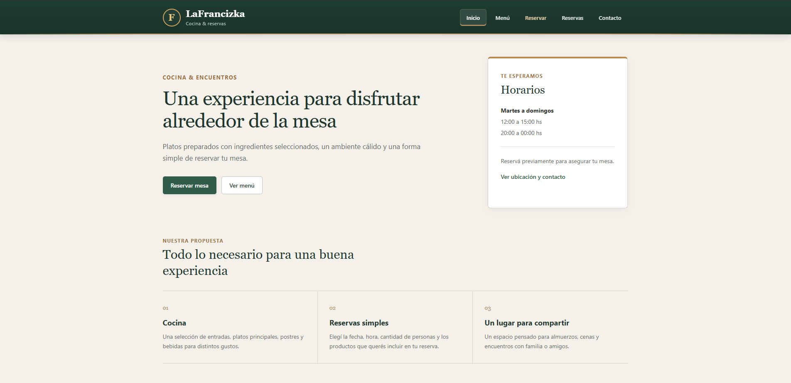
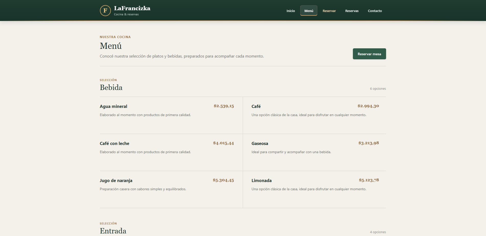
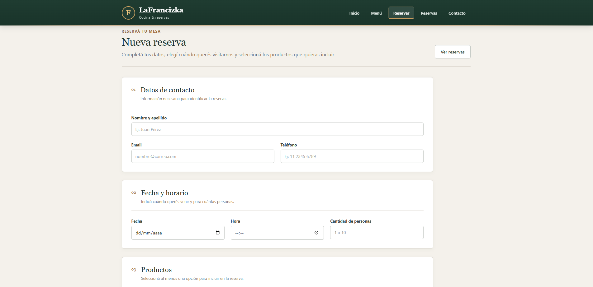
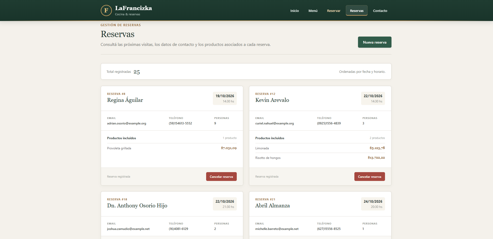
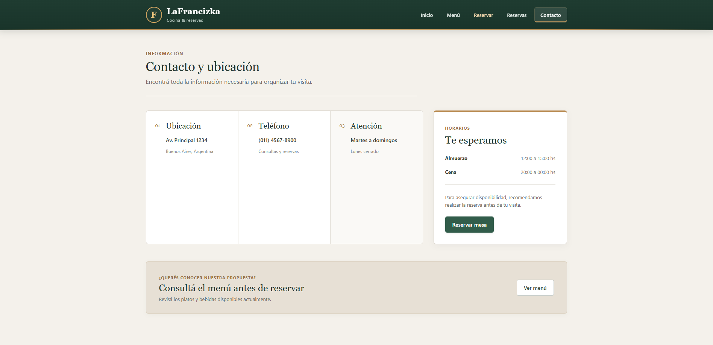

# LaFrancizka - Sistema de Reservas para Restaurante

## Datos del trabajo

**Estudiante:** Joaquin Gonzalez Garcia  
**Proyecto:** LaFrancizka  
**Materia:** Producción Web  
**Tecnología principal:** Laravel 12  

---

## Descripción

LaFrancizka es un sistema web desarrollado en Laravel para la gestión de reservas de un restaurante.

El proyecto cuenta con una parte pública donde se puede consultar información del restaurante, visualizar el menú y acceder a los datos de contacto.

También incluye un sistema de reservas que permite registrar los datos del cliente, seleccionar fecha, horario, cantidad de personas y asociar uno o varios productos disponibles en el menú.

Las reservas registradas pueden consultarse posteriormente junto con sus productos asociados y también pueden ser canceladas.

---

## Tecnologías utilizadas

- PHP 8.2
- Laravel 12
- MySQL / MariaDB
- Blade
- HTML5
- CSS3
- Composer
- Faker
- Eloquent ORM

---

## Requisitos

Para ejecutar el proyecto es necesario contar con:

- PHP 8.2 o superior
- Composer
- MySQL o MariaDB
- XAMPP o un entorno equivalente

---

## Instalación

### 1. Descargar o clonar el proyecto

Clonar el repositorio:

```bash
git clone URL_DEL_REPOSITORIO
```

Ingresar a la carpeta del proyecto:

```bash
cd restaurante-reservas
```

### 2. Instalar las dependencias

Ejecutar:

```bash
composer install
```

### 3. Crear el archivo de entorno

Copiar el archivo:

```text
.env.example
```

y crear una copia con el nombre:

```text
.env
```

### 4. Configurar la base de datos

Crear desde phpMyAdmin o MySQL una base de datos llamada:

```text
restaurante_reservas
```

Luego configurar en el archivo `.env`:

```env
DB_CONNECTION=mysql
DB_HOST=127.0.0.1
DB_PORT=3306
DB_DATABASE=restaurante_reservas
DB_USERNAME=root
DB_PASSWORD=
```

Los valores de usuario y contraseña pueden modificarse según la configuración local de MySQL.

### 5. Generar la clave de Laravel

Ejecutar:

```bash
php artisan key:generate
```

### 6. Ejecutar migraciones y seeders

Ejecutar:

```bash
php artisan migrate:fresh --seed
```

Este comando crea las tablas necesarias y carga automáticamente los datos de prueba.

### 7. Iniciar el servidor

Ejecutar:

```bash
php artisan serve
```

Luego ingresar desde el navegador a:

```text
http://127.0.0.1:8000
```

---

## Rutas principales

| Método | URL | Nombre | Controlador |
|---|---|---|---|
| GET | `/` | `inicio` | `PaginaController@inicio` |
| GET | `/menu` | `menu` | `PaginaController@menu` |
| GET | `/contacto` | `contacto` | `PaginaController@contacto` |
| GET | `/reservas` | `reservas.index` | `ReservaController@index` |
| GET | `/reservas/create` | `reservas.create` | `ReservaController@create` |
| POST | `/reservas` | `reservas.store` | `ReservaController@store` |
| DELETE | `/reservas/{reserva}` | `reservas.destroy` | `ReservaController@destroy` |

---

## Relación entre Productos y Reservas

Para el sistema se implementó una relación de tipo **muchos a muchos** entre los modelos `Producto` y `Reserva`.

Esta relación fue elegida porque una reserva puede incluir varios productos y, al mismo tiempo, un mismo producto puede formar parte de distintas reservas.

La relación se representa mediante la tabla pivote:

```text
producto_reserva
```

La tabla contiene las claves:

```text
producto_id
reserva_id
```

que se relacionan respectivamente con:

```text
productos.id
reservas.id
```

La tabla pivote utiliza claves foráneas y eliminación en cascada para mantener la integridad de los datos.

En los modelos Eloquent la relación se implementa mediante `belongsToMany()`.

### Modelo Producto

```php
public function reservas(): BelongsToMany
{
    return $this->belongsToMany(Reserva::class);
}
```

### Modelo Reserva

```php
public function productos(): BelongsToMany
{
    return $this->belongsToMany(Producto::class);
}
```

Al crear una reserva, los productos seleccionados se vinculan utilizando la tabla pivote.

En el listado de reservas se utiliza la relación para mostrar los productos asociados a cada reserva.

---

## Migraciones

El proyecto utiliza migraciones para crear y mantener la estructura de la base de datos.

Las tablas principales del sistema son:

```text
productos
reservas
producto_reserva
```

La migración de `producto_reserva` se ejecuta después de las tablas `productos` y `reservas`, ya que utiliza claves foráneas hacia ambas tablas.

El proyecto puede reconstruir completamente la base de datos mediante:

```bash
php artisan migrate:fresh --seed
```

---

## Modelo Producto

La tabla `productos` almacena la información correspondiente al menú del restaurante.

Cada producto contiene:

- Nombre
- Descripción
- Precio
- Categoría

El modelo `Producto` utiliza Eloquent ORM y define la relación muchos a muchos con las reservas.

---

## Modelo Reserva

La tabla `reservas` almacena la información de cada reserva realizada.

Cada reserva contiene:

- Nombre del cliente
- Email
- Teléfono
- Fecha
- Hora
- Cantidad de personas
- Observaciones

El modelo `Reserva` utiliza Eloquent ORM y define la relación muchos a muchos con los productos.

---

## Factories y Seeders

El proyecto utiliza Factories, Seeders y Faker para generar datos de prueba automáticamente.

### ProductoFactory

Genera productos con:

- Nombre
- Descripción
- Precio
- Categoría

Los datos utilizados mantienen coherencia entre el nombre del producto, su categoría y su rango de precios.

### ReservaFactory

Genera reservas con:

- Nombre del cliente
- Email
- Teléfono
- Fecha futura
- Horario
- Cantidad de personas entre 1 y 10
- Observaciones opcionales

### Seeders

Actualmente los seeders generan:

```text
20 productos
25 reservas
```

Cada reserva se asocia con uno o varios productos existentes mediante la relación muchos a muchos.

Los seeders principales son:

```text
ProductoSeeder
ReservaSeeder
DatabaseSeeder
```

---

## Validaciones

El formulario de reservas realiza validaciones desde `ReservaController`.

Se valida:

- Nombre obligatorio
- Email obligatorio y con formato válido
- Teléfono obligatorio
- Fecha igual o posterior al día actual
- Hora obligatoria
- Cantidad de personas entre 1 y 10
- Al menos un producto seleccionado
- Existencia de los productos seleccionados en la base de datos
- Observaciones opcionales

Los errores de validación se muestran utilizando:

```text
@error
```

Los datos ingresados previamente se conservan utilizando:

```text
old()
```

El formulario también utiliza protección CSRF mediante:

```text
@csrf
```

---

## Gestión de Reservas

El sistema permite:

- Crear una nueva reserva
- Asociar varios productos a una reserva
- Listar todas las reservas
- Mostrar los productos asociados
- Ordenar las reservas por fecha y hora
- Cancelar una reserva
- Mostrar mensajes de confirmación

La eliminación se realiza mediante una petición:

```text
DELETE
```

utilizando:

```text
@method('DELETE')
```

y Route Model Binding de Laravel.

---

## Arquitectura MVC

El proyecto utiliza el patrón MVC proporcionado por Laravel.

### Modelos

```text
Producto
Reserva
```

### Controladores

```text
PaginaController
ReservaController
```

### Vistas

Las vistas Blade se encuentran organizadas en:

```text
resources/views/layouts
resources/views/paginas
resources/views/reservas
```

Las consultas a la base de datos se realizan mediante los modelos y controladores.

Las vistas se utilizan únicamente para la presentación de la información.

---

## Estructura principal del proyecto

```text
app/
├── Http/
│   └── Controllers/
│       ├── PaginaController.php
│       └── ReservaController.php
│
└── Models/
    ├── Producto.php
    ├── Reserva.php
    └── User.php

database/
├── factories/
│   ├── ProductoFactory.php
│   ├── ReservaFactory.php
│   └── UserFactory.php
│
├── migrations/
│   ├── create_users_table
│   ├── create_cache_table
│   ├── create_jobs_table
│   ├── create_productos_table
│   ├── create_reservas_table
│   └── create_producto_reserva_table
│
└── seeders/
    ├── DatabaseSeeder.php
    ├── ProductoSeeder.php
    └── ReservaSeeder.php

public/
└── css/
    ├── estilos.css
    ├── inicio.css
    ├── menu.css
    ├── reservas.css
    └── contacto.css

resources/
└── views/
    ├── layouts/
    │   └── app.blade.php
    │
    ├── paginas/
    │   ├── inicio.blade.php
    │   ├── menu.blade.php
    │   └── contacto.blade.php
    │
    └── reservas/
        ├── create.blade.php
        └── index.blade.php

routes/
└── web.php
```

---

## Páginas del sistema

### Inicio

Página principal de LaFrancizka con información general del restaurante y accesos al menú y al sistema de reservas.

### Menú

Muestra los productos almacenados en la base de datos agrupados por categoría.

Cada producto muestra:

- Nombre
- Descripción
- Precio
- Categoría

### Reservar

Permite registrar una nueva reserva y seleccionar uno o varios productos.

### Reservas

Muestra las reservas registradas, sus datos principales y los productos relacionados.

También permite cancelar una reserva.

### Contacto

Muestra:

- Dirección
- Teléfono
- Horarios de atención
- Información general para realizar una visita

---

## Capturas del sistema

### Página de Inicio



### Menú



### Nueva Reserva



### Listado de Reservas



### Contacto




## Video demostrativo

Link al video:

```text
AGREGAR_LINK_DEL_VIDEO
```

---

## Repositorio

Repositorio de GitHub:

```text
URL_DEL_REPOSITORIO
```

---

## Consideraciones de seguridad

El archivo:

```text
.env
```

no se encuentra incluido en el repositorio.

Tampoco se incluye la carpeta:

```text
vendor
```

Las dependencias deben instalarse utilizando:

```bash
composer install
```

Para configurar el entorno se proporciona:

```text
.env.example
```

---

## Autor

**Joaquin Gonzalez Garcia**  
Producción Web  
Sistema de Reservas para Restaurante - LaFrancizka